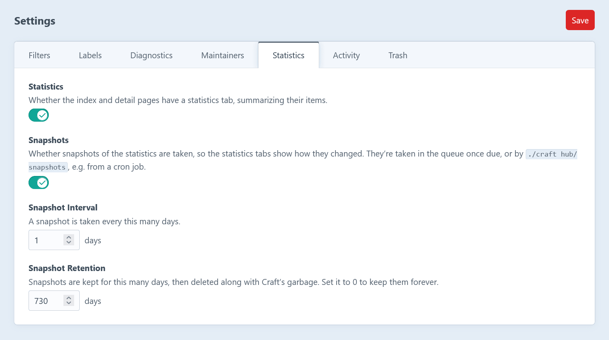

A **snapshot** keeps the statistics as they were on a day. The [_Statistics_ tabs](/features/statistics/) use them to show how things changed.

Each card charts its total and segments over the last 30 days, 90 days, year or all snapshots, and its header shows the change of the total over that range. The live statistics stay as they are.

## Taking snapshots

- A snapshot is taken once a day by default.
- It's pushed to the queue after the first control panel request once one is due, so it works without a cron job.
- For a fixed schedule, run `./craft hub/snapshots` (or `./craft hub/snapshots --queue`) from a cron job. `--force` replaces the snapshot of today.

## What they keep

- The counts of entries, assets and references by the sets of sites their items are on, so they count for any sites, just like the live statistics.
- How sections, entry types, fields and volumes were set up: their types, entry types, field layouts and the fields relating to them. So cards like _In use_, _Empty_, _Unused_, _Usage_, _Data_, _Field Types_ and _Activity_ chart their segments too.
- The statistics of users and of the users of each group.

Snapshots are kept for two years by default, and history starts with the first one. See [configuration](/guide/configuration/) to change that.
