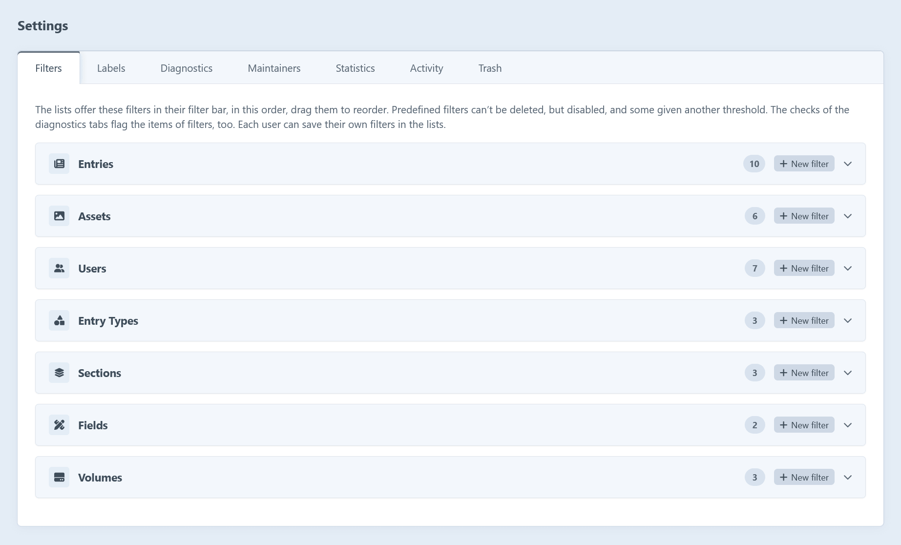

Admins change the settings on the tabs of _Hub → Settings_. _Settings → Plugins → Hub_ leads there too. They're read-only while admin changes aren't allowed.



Or create `config/hub.php`, which takes precedence over the settings saved in the control panel:

```php
return [
	'enableLabels' => true,
	'snapshotInterval' => 1,
	'activityRetentionDays' => 90,
];
```

## Settings

| Setting                 | Default | Description                                                                                       |
| ----------------------- | :-----: | ------------------------------------------------------------------------------------------------- |
| `enableLabels`          | `true`  | Whether items can be [labeled](/features/labels/) and lists filtered by their labels.             |
| `enableMaintainers`     | `false` | Whether sections, entry types, fields and volumes can have [maintainers](/features/maintainers/). |
| `enableDiagnostics`     | `true`  | Whether the index and detail pages have a diagnostics tab.                                        |
| `enableStatistics`      | `true`  | Whether the index and detail pages have a statistics tab.                                         |
| `enableSnapshots`       | `true`  | Whether [snapshots](/features/snapshots/) of the statistics are taken.                            |
| `snapshotInterval`      |   `1`   | A snapshot is taken every this many days.                                                         |
| `snapshotRetentionDays` |  `730`  | Snapshots are kept for this many days. `0` keeps them forever.                                    |
| `enableActivity`        | `true`  | Whether what users do is recorded in the activity log.                                            |
| `activityRetentionDays` |  `90`   | Activities are kept for this many days. `0` keeps them forever.                                   |
| `activityDrafts`        | `false` | Whether drafts created and deleted are recorded too, rather than only once they're applied.       |
| `enableTrash`           | `true`  | Whether the entries and assets pages have a [trash](/features/trash/) tab.                        |
| `keepTrashedFiles`      | `false` | Whether the files of assets moved to the trash are kept, so the assets can be restored.           |

:::tip
Thresholds, like the months after which entries are stale, are set per predefined filter. See [saved filters](/features/saved-filters/).
:::

## Translations

Hub comes in English (the default) and German, following the language of the user's control panel.

To add a language:

1. Copy `src/translations/en/hub.php` to `src/translations/<language>/hub.php`.
2. Translate its values, keeping the keys and placeholders like `{name}` and `{count, plural, …}`.

Tests fail for missing messages and changed placeholders. Messages Craft already has use its own `app` category, so they're translated along with Craft.

## Settings pages

_Hub → Settings_ has a tab per area. Most map to the settings above, and some manage the things behind them.

| Tab             | What it holds                                                                                                      |
| --------------- | ------------------------------------------------------------------------------------------------------------------ |
| **Filters**     | The predefined and custom [saved filters](/features/saved-filters/) of each list.                                  |
| **Labels**      | The [labels](/features/labels/), and whether they're enabled.                                                      |
| **Diagnostics** | The default and custom [checks](/features/checks/), and whether diagnostics are enabled.                           |
| **Maintainers** | Whether [maintainers](/features/maintainers/) are enabled.                                                         |
| **Statistics**  | [Statistics](/features/statistics/) and [snapshots](/features/snapshots/): their switches, interval and retention. |
| **Activity**    | The [activity log](/features/activity/): its switch, retention and whether drafts are recorded.                    |
| **Trash**       | The [trash](/features/trash/) tab and whether the files of trashed assets are kept.                                |
